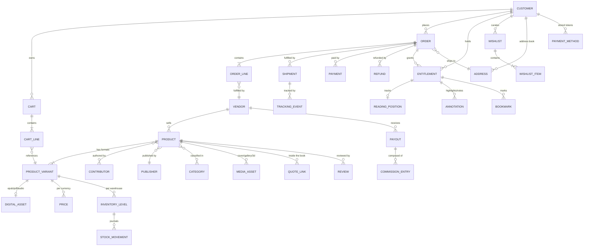

# Book Whispers — Commerce & Publishing Data Model

Companion to [`../REQUIREMENTS.md`](../REQUIREMENTS.md) §11. Defines the persistent domain for the e-commerce and
digital publishing ecosystem.

## 1. Modelling rules

| Rule | Statement |
| --- | --- |
| Money | Stored as `BIGINT` **minor units** plus an ISO-4217 `currency` column. Never `FLOAT`/`REAL`. Every monetary column is paired with its currency or inherits the row's order currency. |
| Tenancy | Every commerce table carries `vendor_id` (FK → `vendor`), first-party = the platform vendor row. Enforced by PostgreSQL row-level security. |
| Identity | UUIDv7 primary keys (time-sortable, index-friendly). External-facing IDs are prefixed (`prod_`, `ord_`) at the API boundary. |
| Time | `TIMESTAMPTZ`, UTC. Business-day logic resolves through the warehouse/destination calendar, not the column. |
| Soft delete | `deleted_at` on catalogue and content entities. **Never** on orders, payments, ledger or entitlement history — those are append-only. |
| Auditing | `created_at`, `updated_at`, `created_by`, `updated_by` on all admin-mutable tables; full diffs in `audit_log`. |
| Schemas | One PostgreSQL schema per module: `catalog`, `pricing`, `inventory`, `cart`, `orders`, `payments`, `entitlements`, `reader`, `reviews`, `vendors`, `promo`, `logistics`. Cross-schema FKs are permitted only toward module-owned identity keys. |

## 2. Entity relationship overview

## 3. Catalogue

### `catalog.product`
The work — format-independent.

| Column | Type | Notes |
| --- | --- | --- |
| `id` | `uuid` PK | |
| `vendor_id` | `uuid` FK | RLS key |
| `slug` | `citext` UNIQUE | Per locale via `product_translation` |
| `status` | `enum` | `DRAFT`\|`IN_REVIEW`\|`SCHEDULED`\|`PUBLISHED`\|`ARCHIVED` |
| `published_at` | `timestamptz` | Drives New Releases module |
| `publisher_id` | `uuid` FK | |
| `series_id`, `series_position` | `uuid`, `int` | Nullable |
| `original_language` | `char(3)` | ISO 639-3 |
| `default_variant_id` | `uuid` | Format shown first on PDP |
| `rating_avg`, `rating_count` | `numeric(3,2)`, `int` | Materialised from `reviews` |
| `metadata` | `jsonb` | Awards, themes, extensible without migration |

`catalog.product_translation` (`product_id`, `locale`) → `title`, `subtitle`, `description_html`, `slug`,
`meta_title`, `meta_description`, `translation_status`.

### `catalog.product_variant` (the sellable SKU)

| Column | Type | Notes |
| --- | --- | --- |
| `id` | `uuid` PK | |
| `product_id` | `uuid` FK | |
| `sku` | `citext` UNIQUE | |
| `format` | `enum` | `HARDCOVER`\|`PAPERBACK`\|`EBOOK`\|`AUDIOBOOK` |
| `is_digital` | `bool` | Excluded from all stock arithmetic (EC-11.6-13) |
| `isbn13`, `isbn10`, `gtin` | `varchar` | Checksum-validated on write (EC-11.6-12) |
| `edition`, `language` | `varchar`, `char(3)` | |
| `page_count` / `duration_seconds` | `int` | Print / audio |
| `weight_grams`, `length_mm`, `width_mm`, `height_mm` | `int` | Shipping rate inputs (EC-11.9-3) |
| `tax_class` | `enum` | `BOOK_PRINTED`\|`BOOK_DIGITAL`\|`STANDARD` — books are frequently zero/reduced rated |
| `hs_code` | `varchar` | Customs (EC-11.9-4) |
| `preorder_release_at` | `timestamptz` | Nullable |

**Indexes:** `(product_id)`, `UNIQUE(isbn13) WHERE deleted_at IS NULL`, `(sku)`, `(format, is_digital)`.

### `catalog.contributor` / `catalog.product_contributor`
Authors, translators, illustrators, narrators, editors as first-class entities (EC-11.6-5):
`product_contributor(product_id, contributor_id, role, sort_order)`.

### `catalog.media_asset`
`kind` ∈ `COVER_FRONT | COVER_BACK | SPINE | INTERIOR | DETAIL | MODEL_3D`, with `storage_key`,
`width`, `height`, `blurhash`, `focal_x/y`, `derivatives jsonb` (AVIF/WebP/JPEG × breakpoints), `alt` per locale.

### `catalog.digital_asset` (protected)
`variant_id`, `file_type` (`EPUB`|`PDF`|`M4B`), `storage_key` (private bucket), `checksum`, `size_bytes`,
`encryption_key_id` (vault reference), `version`, `epubcheck_report jsonb`, `virus_scan_status`.
**No public URL exists for this table's objects** (EC-11.6-4, EC-11.5-19).

## 4. Pricing & promotions

### `pricing.price`
`(variant_id, currency, customer_segment)` → `amount`, `compare_at_amount`, `starts_at`, `ends_at`,
`is_manual_override` (EC-11.9-8), `lowest_prior_30d` (EU Omnibus reference for EC-11.2-10).

### `pricing.fx_rate`
`(base_currency, quote_currency, rate numeric(18,8), markup_bps, fetched_at, provider)` — orders freeze the
applied rate on `orders.order.fx_rate_used` (EC-11.9-7).

### `promo.coupon`
`code citext UNIQUE`, `type` (`PERCENT`|`FIXED`|`FREE_SHIPPING`|`BOGO`|`BUNDLE`), `value`, `currency`,
`scope jsonb` (products/collections/vendors), `min_subtotal`, `stackable`, `usage_limit_total`,
`usage_limit_per_customer`, `starts_at`, `ends_at`, `active`.
`promo.coupon_redemption` (`coupon_id`, `order_id`, `customer_id`, `amount_applied`) enforces caps atomically.

## 5. Inventory

### `inventory.inventory_level`
`(variant_id, warehouse_id)` → `on_hand`, `reserved`, `incoming`, `low_stock_threshold`, `bin_location`.
`available` is derived (`on_hand − reserved`) — never stored (EC-11.2-12).

### `inventory.stock_movement` — append-only journal (EC-11.6-7)
`(id, variant_id, warehouse_id, delta, reason ∈ RECEIPT|SALE|RETURN|ADJUSTMENT|TRANSFER|DAMAGE|RESERVATION|RELEASE,
reference_type, reference_id, actor_id, created_at)`. Levels are a projection of this journal and are
reconcilable against it by the nightly job.

### `inventory.reservation`
`(id, variant_id, warehouse_id, quantity, cart_id | payment_intent_id, expires_at, state)` — created at payment
intent, committed on capture, released on expiry (EC-11.4-21). A background sweeper releases expired rows.

## 6. Cart & orders

### `cart.cart`
`id`, `customer_id` (nullable → anonymous token), `anonymous_token`, `currency`, `locale`, `vendor_scope`,
`coupon_codes text[]`, `expires_at`. Cart lines carry `saved_for_later bool` and `deleted_at` for the 10 s undo
window (EC-11.4-2, EC-11.4-3).

### `orders.order`

| Column | Notes |
| --- | --- |
| `id`, `number` | Human-readable sequential `number` per tenant |
| `customer_id` \| `guest_email` | Guest checkout (EC-11.4-13) |
| `state` | `PENDING`→`AUTHORIZED`→`PAID`→`PROCESSING`→`SHIPPED`→`DELIVERED`; plus `CANCELLED`, `REFUNDED`, `PARTIALLY_REFUNDED` |
| `currency`, `fx_rate_used` | Frozen at placement (EC-11.9-7) |
| `subtotal`, `discount_total`, `shipping_total`, `tax_total`, `grand_total` | Minor units |
| `tax_breakdown jsonb` | Per jurisdiction/rate — feeds the §11.6.3 filing report |
| `billing_address_id`, `shipping_address_id` | Snapshotted, immutable copies |
| `placed_at`, `idempotency_key` | Replay-safe creation (EC-11.0-3) |

### `orders.order_line`
`order_id`, `variant_id`, `vendor_id`, `quantity`, `unit_price`, `compare_at_price`, `discount_amount`,
`tax_amount`, `tax_rate`, `commission_rate`, `commission_amount`, `is_digital`,
plus a **product snapshot** (`title`, `authors`, `isbn13`, `cover_url`, `format`) so historical orders and
invoices never mutate when the catalogue changes.

### `orders.shipment` / `logistics.tracking_event`
`shipment(order_id, vendor_id, warehouse_id, carrier, service_level, tracking_number, label_url, weight_grams,
shipped_at, estimated_delivery_from, estimated_delivery_to, state)`;
`tracking_event(shipment_id, canonical_status, carrier_status_raw, description, location, occurred_at,
received_at)` — normalised from carrier webhooks (EC-11.9-2), unique on `(shipment_id, carrier_event_id)` for
idempotency.

### `payments.payment` / `payments.refund`
`payment(order_id, provider, provider_payment_intent_id, method, brand, last4, amount, currency, state,
authorized_at, captured_at, failure_code, raw_event_id)`. No PAN, no CVV, ever (EC-11.4-17).
`payments.webhook_event(provider, provider_event_id UNIQUE, payload jsonb, processed_at)` guarantees
exactly-once processing (AC-11.4-D).

## 7. Entitlements & reading

### `entitlements.entitlement`
`(id, customer_id, variant_id, order_id, source ∈ PURCHASE|GIFT|PROMO|SUBSCRIPTION, granted_at, revoked_at,
revoke_reason, licence_type ∈ SOCIAL_WATERMARK|LCP, download_count, max_downloads)`.
`UNIQUE(customer_id, variant_id) WHERE revoked_at IS NULL` — enforces "already owned" (EC-11.4-10).

### `reader.reading_position`
`(entitlement_id, device_id, cfi, percent, chapter_href, updated_at)` — furthest-position reconciliation across
devices (EC-11.5-10).

### `reader.annotation`
`(id — client-generated UUID for offline idempotency, entitlement_id, kind ∈ HIGHLIGHT|NOTE, cfi_range,
selected_text, note_text, color, created_at, updated_at, deleted_at, synced_at, shared_quote_id)`.
`shared_quote_id` links a highlight promoted into the public Quotes domain (EC-11.5-11).

### `reader.bookmark`
`(id, entitlement_id, cfi, label, created_at)`.

### `reader.reading_session`
`(entitlement_id, started_at, ended_at, pages_turned, seconds_read, device_kind)` — feeds stats and the
recommender (EC-11.5-17, EC-11.7-13); user-suppressible.

## 8. Customers, reviews, vendors

- `customers.customer`, `customers.address` (locale-aware fields, `is_default_shipping`, `is_default_billing`),
  `customers.payment_method` (provider token, brand, last4, expiry — **token only**).
- `customers.wishlist` / `wishlist_item` with `visibility ∈ PRIVATE|UNLISTED|PUBLIC` and `share_token`.
- `reviews.review` (`product_id`, `customer_id`, `order_id` → verified-buyer derivation EC-11.3-14, `rating`,
  `title`, `body`, `format_purchased`, `locale`, `moderation_state`, `helpful_count`),
  `reviews.review_vote`, `reviews.qa_question`, `reviews.qa_answer` (`answerer_role`).
- `reviews.rating_aggregate` (`product_id`, `avg`, `count`, `histogram int[5]`) — materialised, refreshed on
  review events (EC-11.3-12).
- `vendors.vendor` (`name`, `slug`, `status`, `commission_rate_default`, `connect_account_id`, `kyc_state`,
  `policies jsonb`), `vendors.commission_entry` (per order line), `vendors.payout`
  (`period_start`, `period_end`, `gross`, `commission`, `refund_clawback`, `net`, `state`, `statement_url`).

## 9. Search & recommendation projections

Denormalised, rebuilt from domain events — never written by request handlers (EC-11.7 preamble).

| Projection | Contents | Freshness |
| --- | --- | --- |
| `search_product_{locale}` | Title, contributors, publisher, ISBNs, description, taxonomy paths, facet fields, price per currency, availability, rating, popularity score | ≤ 60 s (price/catalogue), ≤ 30 s (stock) |
| `search_content_{locale}` | Blog posts, quotes, reviews — the "Content" result group (EC-11.7-8) | ≤ 5 min |
| `reco_item_embedding` | Vector per product from title/description/taxonomy | Nightly + on publish |
| `reco_interaction` | `(pseudonymous_user, item, event_type, weight, occurred_at)` feature store | Streaming |

## 10. Indexing, partitioning & performance notes

- `orders.order` partitioned by `placed_at` month; `logistics.tracking_event` and `reader.reading_session`
  partitioned by month — analytics and retention both operate per partition.
- Hot read paths: `product_variant(product_id)`, `price(variant_id, currency)`,
  `inventory_level(variant_id)`, `entitlement(customer_id) WHERE revoked_at IS NULL`,
  `annotation(entitlement_id, deleted_at)`, `order(customer_id, placed_at DESC)`.
- Reporting (§11.6.3) reads a replica or warehouse projection only (EC-11.6-19).
- Row-level security policies keyed on `vendor_id` are applied to every table in `catalog`, `pricing`,
  `inventory`, `orders` and `vendors` (EC-11.8-2); the connection sets `app.vendor_id` per request.
- `platform.outbox` (`id`, `aggregate_type`, `aggregate_id`, `event_type`, `payload jsonb`, `occurred_at`,
  `published_at`) is written in the same transaction as every domain mutation (EC-11.0-2).
